# Telco Customer Churn Prediction

An end-to-end data science project: from raw customer records to a validated churn-risk model, statistically backed insights, and actionable retention recommendations.

**Headline result:** a tuned Gradient Boosting model reaches **ROC-AUC 0.854** (95% CI 0.834-0.874) on a held-out test set. Contacting the **top 20% of customers by predicted risk captures 50.5% of all churners**, and the highest-risk decile churns at **75.9% vs a 26.5% average**.

## Dataset

IBM's public **Telco Customer Churn** sample dataset (fictional California telecom): 7,043 customers x 33 columns - demographics, account information, subscribed services, billing, and the churn outcome. 

## Key EDA findings

### Class balance and revenue at stake
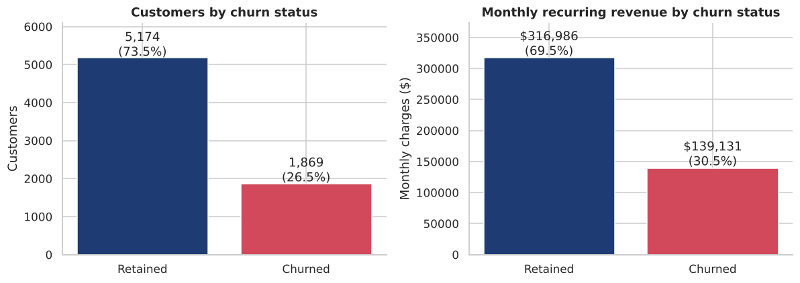

### Churners leave early and pay more
Median tenure is **10 months for churners vs 38 for retained customers**; 52.9% of customers in their first 6 months churn.

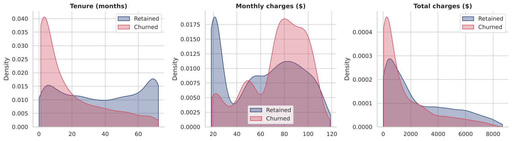

### Churn rate by category
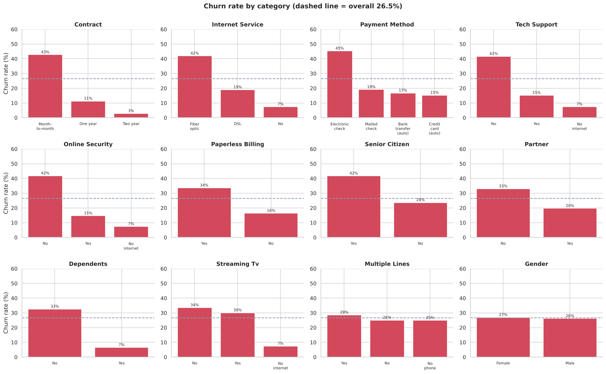

| Factor | Churn rate |
|---|---|
| Contract: month-to-month / one-year / two-year | **42.7%** / 11.3% / 2.8% |
| Internet: fiber optic / DSL / none | **41.9%** / 19.0% / 7.4% |
| Payment: electronic check / automatic bank or card | **45.3%** / 16.0% |
| Tech support: no / yes | **41.6%** / 15.2% |
| Online security: no / yes | **41.8%** / 14.6% |
| Paperless billing: yes / no | 33.6% / 16.3% |
| Senior citizen: yes / no | 41.7% / 23.6% |
| Dependents: no / yes | 32.6% / 6.5% |

### Tenure x contract
Month-to-month customers churn heavily at every tenure, while two-year customers almost never leave in the first two years.

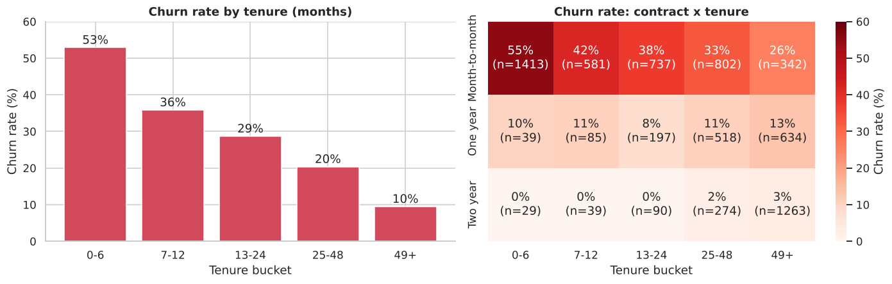

### Fiber, support add-ons and price
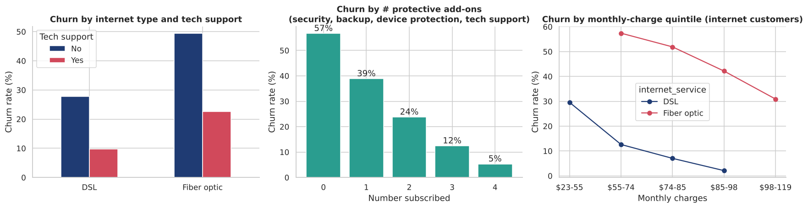

### Statistical strength of association
Cramer's V (categorical) and univariate AUC (numeric). `gender` and `phone_service` are not significant.

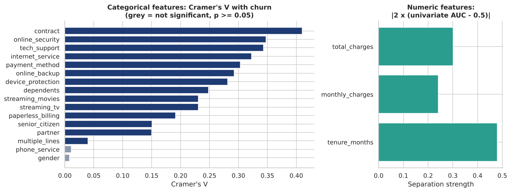

### Why customers say they left (descriptive only, recorded after churn)
Competitor offers are the largest theme (33.2% of churners), followed by support & service quality (29.1%), network/product issues (15.7%) and price/charges (10.6%). The grouping into themes is a manual mapping documented in notebook 01.

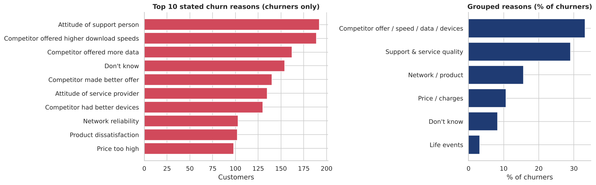

### High-risk segment
Month-to-month + fiber + no tech support + tenure <= 12 months: **833 customers (11.8% of base), 71.1% churn, 31.7% of all churners.**
Month-to-month customers overall make up **88.6% of all churners**.

## 6. Modelling & evaluation

**Protocol.** Stratified 80/20 split (5,634 train / 1,409 test, seed 42). All preprocessing and feature engineering sit inside one scikit-learn `Pipeline`, so nothing leaks from validation folds. Models were compared with 5-fold stratified CV on the training data (primary metric ROC-AUC, secondary PR-AUC), tuned with `RandomizedSearchCV` (12 samples each), and the best was selected by CV score. The test set was used only once for the final report.

**Engineered features:** number of add-on services (all / protective only), average monthly spend, gap between current and historical charge, autopay flag, has-internet flag, tenure bucket.

**Candidates:** Logistic Regression, Random Forest, Gradient Boosting, HistGradientBoosting (plus a Dummy baseline, AUC 0.500).

| Model (tuned) | CV ROC-AUC (mean +/- std) | OOF PR-AUC | Test ROC-AUC | Test PR-AUC | Test Brier |
|---|---|---|---|---|---|
| Logistic Regression | 0.8604 +/- 0.0118 | 0.679 | 0.852 | 0.661 | 0.134 |
| Random Forest | 0.8594 +/- 0.0086 | 0.674 | 0.853 | 0.667 | 0.152 |
| **Gradient Boosting (selected)** | **0.8630 +/- 0.0113** | **0.682** | **0.854** | **0.672** | **0.133** |
| HistGradientBoosting | 0.8621 +/- 0.0100 | 0.678 | 0.854 | 0.671 | 0.133 |

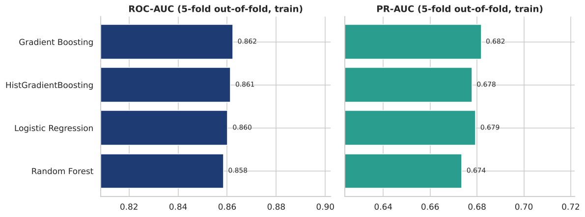
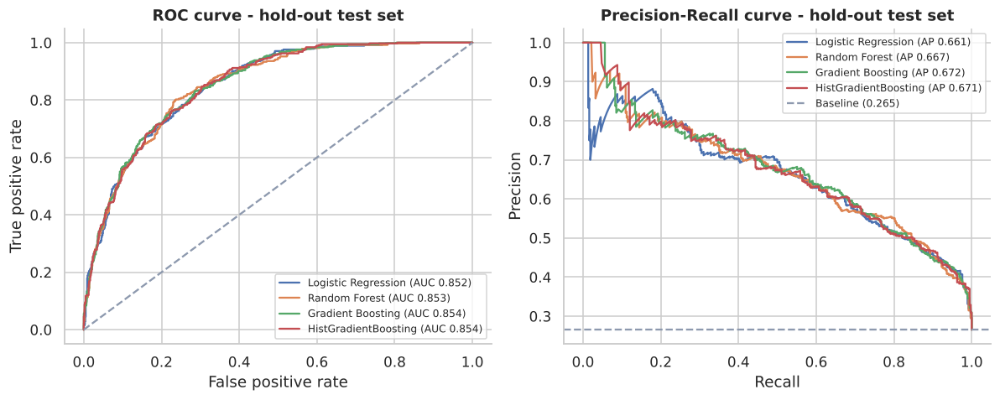

**Honest reading:** the four models are statistically very close (differences are smaller than fold-to-fold standard deviation). Gradient Boosting was selected because it had the best CV score under the rule fixed in advance; a plain regularised Logistic Regression is nearly as good and fully interpretable. Test metrics were *not* used to choose the model.

## 7. Final model

**Gradient Boosting** (`learning_rate=0.040, n_estimators=300, max_depth=2, min_samples_leaf=40, subsample=0.85`), saved at [`models/best_model.joblib`](models/best_model.joblib).

The decision threshold (**0.33**) was chosen by maximising F1 on *out-of-fold training* predictions, not on the test set.

| Hold-out test metric | Threshold 0.50 | Threshold 0.33 (chosen) |
|---|---|---|
| ROC-AUC | 0.854 (95% CI 0.834-0.874) | same |
| PR-AUC | 0.672 (95% CI 0.622-0.720) | same |
| Accuracy | 0.813 | 0.778 |
| Precision | 0.676 | 0.563 |
| Recall | 0.564 | **0.727** |
| F1 | 0.615 | **0.635** |
| Brier score | 0.133 | same |

At threshold 0.33 the model flags 483 customers: 272 true churners caught, 102 missed, 211 false alarms (confusion matrix below). The lower threshold trades precision for recall - appropriate when missing a churner is costlier than a retention offer to someone who would have stayed.

| Confusion matrix @0.33 | Predicted stay | Predicted churn |
|---|---|---|
| Actually stayed | 824 | 211 |
| Actually churned | 102 | 272 |

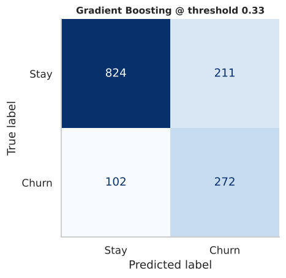
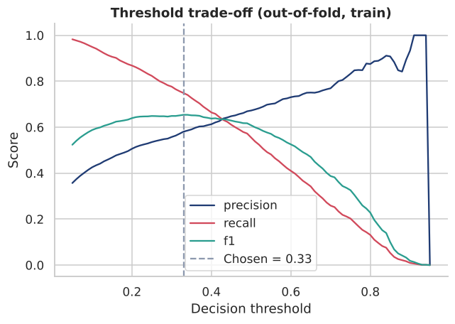

**Calibration.** Predicted probabilities track observed churn rates well for the selected model, so scores can be used as risk estimates.

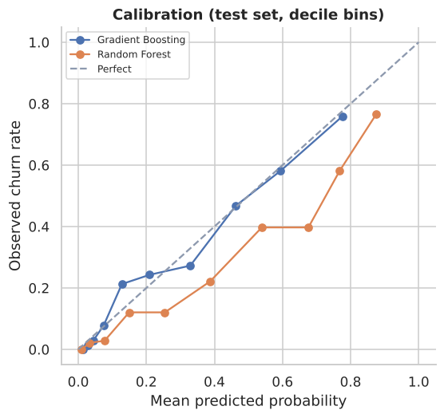

**Business lift.** Customers ranked by predicted risk:

| Customers contacted (highest risk first) | Share of all churners captured |
|---|---|
| Top 10% | 28.6% (churn rate in this group: 75.9%) |
| Top 20% | 50.5% |
| Top 30% | 67.9% |
| Top 40% | 78.3% |

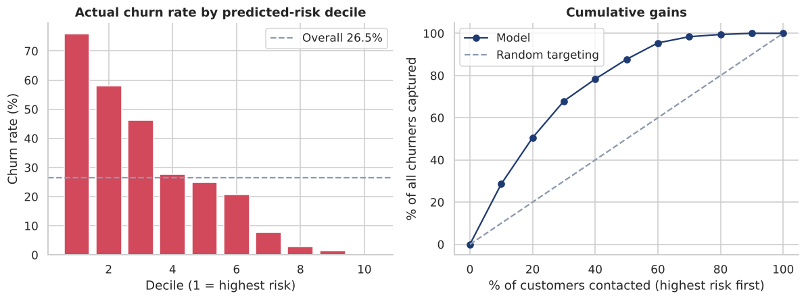

Using simple probability tiers on the test set: **Low (<0.30)** 882 customers, 10.0% churned; **Medium (0.30-0.60)** 322 customers, 42.5% churned; **High (>0.60)** 205 customers, 72.7% churned.

## 8. What drives churn

**Permutation importance** (drop in test ROC-AUC when a customer attribute is shuffled): `tenure_months` (0.088) >> `contract` (0.046) > `dependents` (0.031) ~ `internet_service` (0.030); everything else is below 0.003 individually.

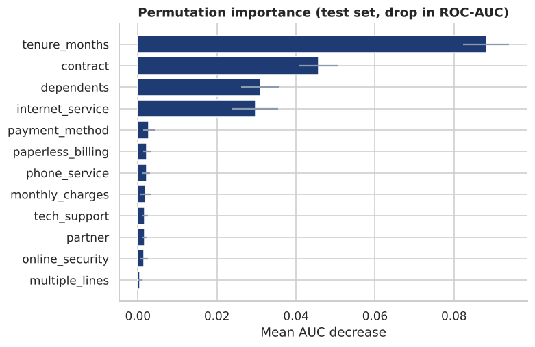

**Direction of effects** (standardised logistic-regression coefficients): month-to-month contract, fiber optic, and tenure of 0-6 months increase churn odds; two-year contracts, longer tenure, having dependents and subscribing to protective services (online security, tech support, etc.) reduce them.

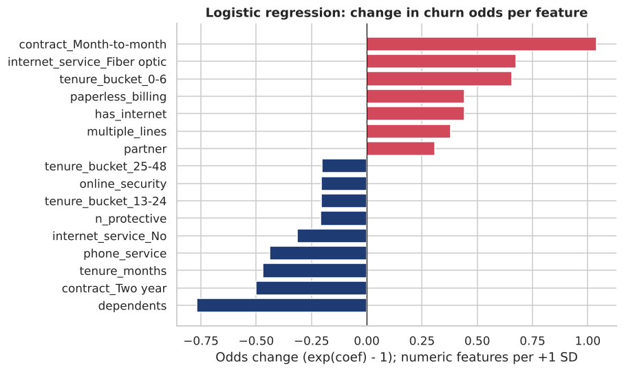

Reading these charts carefully: tenure, total charges, average spend and monthly charges are highly correlated, and `has_internet` duplicates `internet_service_No`, so individual coefficients can flip sign (e.g. `partner`) and should be interpreted as a group. Permutation importance also understates attributes whose information is shared with others (tech support, online security). The EDA rates above are the more reliable single-factor view.

## 9. Business recommendations

These are based on associations in observational data; validate with A/B tests before scaling.

1. **Move month-to-month customers onto longer contracts.** Month-to-month customers are 88.6% of churners; one-year and two-year contracts churn at 11.3% and 2.8%. Offer a discount, device credit or price lock for 12-month commitments, prioritising customers with a High risk score.
2. **Fix the first six months.** 52.9% of customers in their first 6 months churn. Add onboarding check-ins, a 30/60/90-day outreach cadence and early service-quality monitoring for new fiber customers.
3. **Investigate fiber.** Fiber has 41.9% churn vs 19.0% for DSL, and customers who left cite competitor speeds/offers and network issues. Review price-to-performance and local reliability, and benchmark competitor offers.
4. **Bundle tech support and online security.** Customers without them churn at ~42% vs ~15% with them. Trial free or discounted bundles for at-risk fiber / month-to-month customers and measure uplift (customers who buy support may simply be more engaged, so test causally).
5. **Nudge electronic-check payers to autopay.** 45.3% vs 16.0% churn; a small autopay incentive is cheap to try.
6. **Run a model-driven retention campaign.** Contact the top 20% by risk (captures 50.5% of churners) with offers matched to the likely reason; keep a random holdout to measure true incremental retention. Choose the threshold from actual offer cost vs customer value - the 0.33 threshold maximises F1, not profit.
7. **Invest in support quality.** 29.1% of stated churn reasons are about support/service quality (attitude, expertise, self-service).
8. **Operationalise.** Score customers monthly, monitor score distribution and calibration drift, and retrain regularly.

## 10. Limitations

- Single snapshot, no timestamps: we predict *who*, not *when*, and cannot examine price changes or campaigns over time.
- The data is a public IBM sample (fictional company, one US state); performance and patterns may not transfer to a real operator.
- Associations are not causal effects; recommendations need experimentation.
- `dependents` shows an unusually strong effect (6.5% vs 32.6% churn) that may be a feature of how this sample was generated - treat with caution.
- Model differences are within noise; AUC ceiling around 0.85-0.86 suggests remaining churn drivers are not captured (usage, billing disputes, network incidents, competitor pricing).
- Threshold is F1-based, not cost-based; the model rarely catches churners on 1-2 year contracts at the chosen threshold (very few such churners: 12% and 2.7% churn in the test set), although ranking quality (AUC 0.82-0.83) within those segments is similar.
- XGBoost/LightGBM were not available in the build environment; scikit-learn boosting models were used instead.
